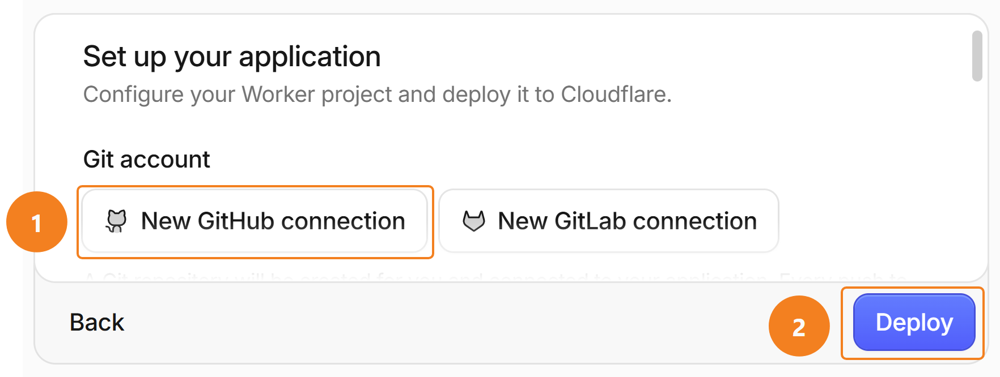
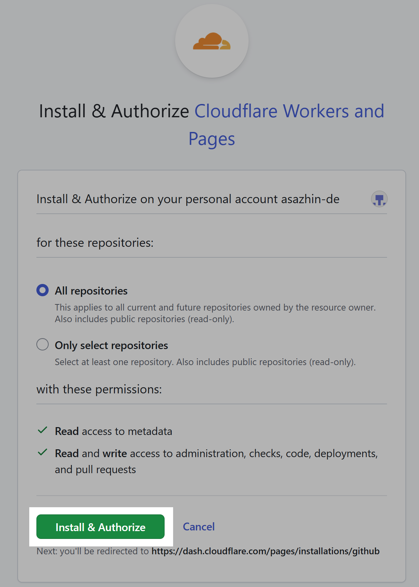
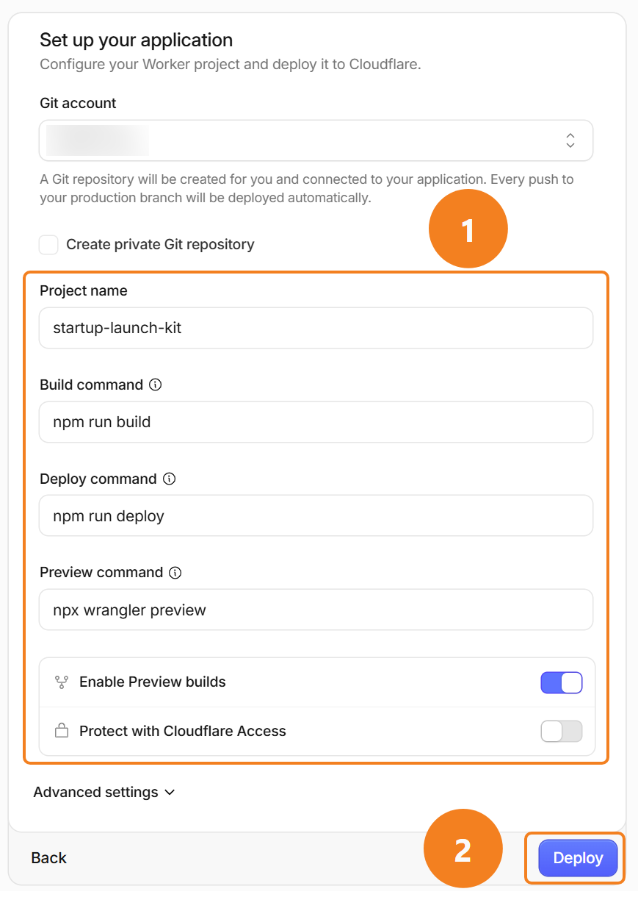

# Level 1: Your landing page

**Goal:** put a landing page about your startup on the internet, at your own address.

## What you'll build

A complete startup website. The starter site is about a fictional startup, **Plovify** ("Plov as a Service"): replace it with yours, or keep it and tweak it. It has a navigation bar with a kazan logo, a big headline with buttons, an illustration in your brand colour, key numbers, features with icons, a menu, a "How it works" section, an FAQ and a blog with two sample posts. It works on phones and switches to dark mode automatically. You personalise it by changing a few lines of text. It is served from Cloudflare's global network, so it loads fast in Tashkent, Almaty or London. Every change you save on GitHub goes live automatically in about a minute.

## Building blocks

- **Workers static assets:** Cloudflare stores your website files (HTML, CSS, images) and serves them from data centers close to each visitor.
- **Workers Builds (CI/CD):** when you save a change in GitHub, Cloudflare rebuilds and republishes your site for you.
- **Astro:** a popular tool that turns simple files (a settings file and Markdown blog posts) into a fast website. You only edit one file: `src/config.ts`.

## Steps

### Part A: Deploy the starter site (about 7 minutes)

We do Part A together at the very start of the workshop. While your site builds, the presenter explains how Cloudflare works. Part B comes after the theory.

1. Log in to https://dash.cloudflare.com in your browser.
2. In a new tab, open this link (it is the Level 1 **Deploy to Cloudflare** button):
   https://deploy.workers.cloudflare.com/?url=https://github.com/asazhin-dev/startup-launch-kit/tree/main/level-1
3. If Cloudflare asks you to choose an account, choose your account.
4. Under **Git account**, click **New GitHub connection**.
     
   A GitHub page opens asking to install **Cloudflare Workers and Pages** on your account.
   Keep **All repositories** selected and click **Install & Authorize**.
   GitHub then sends you back to Cloudflare automatically.
   
   
   > This lets Cloudflare create your repository and rebuild your site when you change it.
   > You can limit access to specific repositories later in GitHub → Settings → Applications.

6. The setup page shows several fields. Fill them in like this:

   | Field | What to do |
   | --- | --- |
   | **Git account** / GitHub account | Choose your own GitHub account (the one you just connected). |
   | **Repository name** | Keep the default, `startup-launch-kit`. Only if GitHub says it is already taken, change it (for example `startup-launch-kit-2`). |
   | **Private / Public** repository | Either is fine. Private keeps your code to yourself. |
   | **Worker name** / project name | **Keep `startup-launch-kit`.** |
   | **Build command**, **Deploy command**, **Advanced settings** | Leave them exactly as they are. |
   | Other resource settings (if shown) | Keep the suggested settings. |

   > ⚠️ If you **do** change the Worker name, write it down now. You will need it in Level 2.
   
   

7. Click **Create and deploy** (the button text may be slightly different, for example **Deploy**).
8. Wait 1–3 minutes. You will see the build progress. Do not close the tab.

   > [SCREENSHOT: deployment progress screen with build steps]

9. When it finishes, click the link to your site (it ends in `.workers.dev`). You should see a complete website for the fictional startup **Plovify**, with the headline **"Plov as a Service"**. Scroll down to see the features, menu, FAQ and footer, and click **Blog** in the top menu.

   > [SCREENSHOT: the Plovify starter site: kazan logo and top menu, orange "Get in touch" button, headline "Plov as a Service", steaming kazan illustration on the right, numbers strip, feature cards with icons]
10. Copy that address from your browser's address bar and keep it somewhere (a note or the chat). This is **your live URL**.

> **Tip: how to find your live URL later.** In the Cloudflare dashboard, open **Workers & Pages** in the left menu (or type "Workers" in the search bar at the top), click your Worker `startup-launch-kit`. Your `.workers.dev` address is shown on the Worker's overview page (look for **Domains & Routes** or a **Visit** link).

### Part B: Make it about YOUR startup (about 18 minutes)

10. Open your repo on GitHub: go to `https://github.com/<your-github-username>/startup-launch-kit` (use your repo name if you changed it). Or click the GitHub repository link on the Cloudflare page.
11. Click the folder `src`, then click the file `config.ts`.
12. Click the **pencil icon** (✏️ "Edit this file") at the top right of the file.

    > [SCREENSHOT: GitHub file view of src/config.ts with the pencil icon highlighted]

13. At the top of the file you see a block called **EDIT: basics**. It looks like this:

    ```ts
    name: "Plovify",
    tagline: "Plov as a Service",
    description:
      "Plovify brings hot, fresh plov to every table, from a family dinner to a wedding for 800 guests. ...",
    ```

    Change the text **between the double quotes** `"..."` for `name`, `tagline` and `description` to your startup. Keep the quotes and the commas. For example:

    ```ts
    name: "Your Startup Name",
    tagline: "What you do, in one short sentence.",
    description:
      "One or two sentences: the problem you solve and who it is for.",
    ```

    No startup idea yet? Keep Plovify and just change a word or two, for example the tagline.

14. **Building your own startup?** A few lines below, set the switch to `false`:

    ```ts
    showPlovifyExamples: false,
    ```

    This hides all Plovify sample content (menu, numbers, plov FAQ, the two sample blog posts and the "Plovify is fictional" footer) and uses neutral texts with **your** startup's name instead, for example "Join the Your Startup Name waitlist" and "Ask Your Startup Name". Keeping Plovify? Leave it `true`.
15. Optional, in the same block: change `accentColor` to your brand colour as a hex code (for example `"#2563eb"` for blue, `"#16a34a"` for green), and `contactEmail` to your email. Keep the `#` and the quotes. Leave everything else as it is for now; the **OPTIONAL: more sections** block (features, menu, steps, numbers, FAQ) is empty on purpose and shows the Plovify examples or neutral texts. You can add your own items there after the workshop (the comments in the file show how). Do **not** change `enableWaitlist` or `enableAssistant`. Leave them `false` for now.

    > **Rules so you don't break the file:**
    > - Keep every double quote `"` and every comma `,` at the end of the line.
    > - If your text needs quotes, use single quotes inside: `"The 'Uber' for tailors"`.
    > - Apostrophes are fine, so Uzbek text like `"O'zbekiston"` works.
    > - Type your text directly in the GitHub editor. Text pasted from Word, Google Docs or a phone may contain "curly" quotes `“ ”` that break the build. If you paste, retype the outer quotes `"` in the editor.

16. Click the green **Commit changes...** button at the top right.
17. In the pop-up, keep **Commit directly to the `main` branch** selected and click **Commit changes**.

    > [SCREENSHOT: GitHub commit dialog with "Commit directly to the main branch" selected]

18. Wait about 1 minute. On your repo's main page, next to the latest commit message, you will see a small **yellow dot** (building). It turns into a **green check ✓** when your site is live, or a **red ✗** if the build failed.

    > [SCREENSHOT: GitHub repo page showing the yellow dot / green check next to the latest commit]

19. When you see the green check, open your live URL and refresh the page (Ctrl+F5 on Windows, Cmd+Shift+R on Mac). You should see your startup's name in the top menu, your tagline as the big headline, and your description below it. The illustration shows your name too. If you set `showPlovifyExamples: false`, the menu, numbers and FAQ are gone and the blog says "Our first post is coming soon." If you changed `accentColor`, the buttons and highlights now use your colour.

    > [SCREENSHOT: personalised site with a custom name, headline and a blue accent colour]

> **How to see the build log.** On GitHub, click the yellow dot / green check / red ✗ next to the commit, then **Details**. Or in the Cloudflare dashboard: **Workers & Pages** → your Worker → **Deployments** tab (or **Builds**) → click the latest build → **View build log**. A red ✗ means something went wrong: see [Troubleshooting](troubleshooting.md#build-failed).

## Checkpoint ✅

Paste your live URL in the workshop chat, for example:

`Level 1 done: https://startup-launch-kit.your-name.workers.dev`

## What just happened

You published a real website on Cloudflare's global network, with a free HTTPS address, and connected it to GitHub so every change goes live automatically. Cloudflare ran `npm run build`: Astro turned your settings in `config.ts` and the Markdown blog posts into ready-made static pages (home, blog, one page per post, 404). Then `wrangler deploy` uploaded the files to Cloudflare's network. Your site now runs in Cloudflare's network in 330+ cities in 125+ countries. There is no server for you to manage, and static file requests are free and unlimited on the free plan.

**On AWS** you'd typically use Amplify Hosting or S3 + CloudFront, choose a region, and add a payment card at sign-up (required even on the AWS Free plan, which closes after 6 months).

**In production:** connect your own domain (for example a `.uz` domain); HTTPS and DDoS protection are already on. Your prototype is your production: no rewrite, no migration.

## Stuck?

- First check [Troubleshooting](troubleshooting.md).
- If the Deploy button flow fails completely, ask a helper in the chat. Most problems are an unverified email or the GitHub connection.
- You can continue to Level 2 even if your text is not perfect yet; you can edit `src/config.ts` any time.

## Bonus for fast finishers: publish your first blog post (about 3 minutes, optional)

Only do this if you are done and waiting. It is **not** needed for Level 2.

1. In your repo on GitHub, click the folder `src`, then `content`, then `blog`. You see the two Plovify sample posts (they are hidden on your site if `showPlovifyExamples` is `false`; your own post always shows).
2. Click **Add file** → **Create new file**.
3. Check that the path above the file-name box shows `src/content/blog/`. In the file name box, type exactly: `my-first-post.md`
   (If the path is different, delete what is in the name box and type the full path instead: `src/content/blog/my-first-post.md`.)
4. Paste this text and change the parts you like (keep the three `---` lines and the quotes):

   ```markdown
   ---
   title: "Hello from our team"
   description: "A short introduction to who we are and what we are working on."
   pubDate: 2026-01-31
   author: "Your Name"
   ---

   Hi, we are the team behind our startup. We are building something to make life easier for our customers, and this blog is where we will share our progress.

   Follow along, join the waitlist, and tell us what you think. We read every message.
   ```

   `2026-01-31` is only an example: set `pubDate` to today's date (format YYYY-MM-DD). The newest date appears first on the blog.
5. Click **Commit changes...** → **Commit directly to the `main` branch** → **Commit changes**.
6. Wait for the **green check ✓**, then open your live URL with `/blog` at the end (for example `https://startup-launch-kit.your-name.workers.dev/blog`). Your post is in the list. Click it to read it.

Red ✗? See [Troubleshooting: blog post errors](troubleshooting.md#blog-post-errors).

---

Next: [Level 2: Waitlist and database →](02-level-2-waitlist.md)
